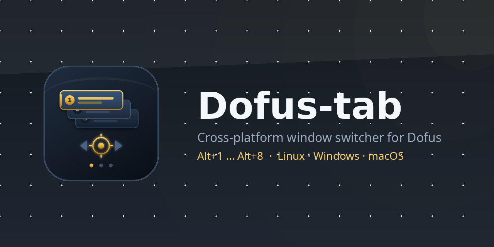

# Dofus-tab

<picture>
  <source media="(prefers-color-scheme: dark)" srcset="packaging/banners/github-banner.png">
  <source media="(prefers-color-scheme: light)" srcset="packaging/banners/github-banner-light.png">
  
</picture>

Cross-platform window switcher for playing Dofus with several accounts.

It maps every running Dofus client to a numbered tab and lets you jump between
them instantly. Unlike the existing tools it targets **Linux, Windows and
macOS** from a single codebase.

> **Status:** v0. Linux and macOS work end to end and have been used on real
> hardware. The Windows backend is complete and covered by CI on a Windows
> runner, but nobody has run it yet. On macOS the hotkeys live in the overlay
> bar only, not the daemon. See [Roadmap](#roadmap).

## Scope

Dofus-tab only **switches focus between windows** and lets you name and order
them. It deliberately does not broadcast input to several clients, automate
gameplay, or read game memory. Multi-accounting is allowed by Ankama; automation
and input broadcasting are not.

## Install

Requires Rust 1.89 or newer — that is where the standard library gained the file
locking used to stop two processes registering the hotkeys at once.

### Linux

```sh
./packaging/install.sh
```

That builds, then installs the binaries into `~/.local/bin`, the icons into
`~/.local/share/icons` and the desktop entry into `~/.local/share/applications`.

**Installing is not optional on Linux**, at least if you want global hotkeys.
The XDG desktop portal derives the application identity from the systemd scope
the launcher puts the process in, and it only accepts that identity if a
matching desktop entry exists *and* its `Exec` resolves to the binary that is
running. Start the bar from your application menu, not from a terminal; a
terminal-launched process inherits the terminal's identity, so the shortcuts end
up filed under it.

Two details that cost an afternoon to find, in case you fork this:

- The application id must not contain a hyphen. The portal parses the scope name
  as `app-<id>-<random>`, so `dofus-tab` is ambiguous with the
  `app-<launcher>-<id>-<random>` form and resolves to an empty id, which the
  portal rejects with `NotAllowed: An app id is required`. Hence the reverse-DNS
  `io.github.gambl3r08.DofusTab`.
- The desktop entry's `Exec` must resolve to the running binary, either as an
  absolute path or as a bare name that is on `PATH`.

To run from a checkout without installing:

```sh
cargo build --release
./target/release/dofus-tab list        # command line
./target/release/dofus-tab-bar         # overlay bar (hotkeys will not register)
```

### macOS

```sh
./packaging/install-macos.sh
```

That builds and assembles `~/Applications/DofusTab.app`, generating the icon set
with `iconutil` along the way. Launch it from Spotlight or Launchpad.

The bundle matters for more than tidiness: its `Info.plist` sets `LSUIElement`,
which is what makes macOS treat Dofus-tab as a menu bar application rather than
putting it in the Dock. A bare binary works for testing but behaves like an
ordinary app.

None of this needs permissions. `NSRunningApplication` and Carbon hotkeys were
chosen precisely to avoid the Accessibility and Screen Recording prompts that a
window-level approach would have required.

### Windows

No installer yet; build with `cargo build --release` and run
`target\release\dofus-tab-bar.exe`.

## Usage

```sh
dofus-tab list             # show the detected clients as numbered tabs
dofus-tab focus 2          # focus a tab by slot
dofus-tab focus enutrof    # ...or by part of its label
dofus-tab label 1 "Iop"    # rename a tab (empty string restores the nickname)
dofus-tab save             # persist the current order across restarts
dofus-tab daemon           # register the global hotkeys and listen
dofus-tab doctor           # report what the platform layer detects
```

Example:

```
$ dofus-tab list
  1  someone#1546                  account=62833850     pid=11825    window=0x220000a
  2  Iop                           account=62845763     pid=12904    window=0x2400012
```

## The overlay bar

```sh
cargo run --release --bin dofus-tab-bar
```

`dofus-tab-bar` is a thin always-on-top strip with one button per detected
client. The tab of the focused client is highlighted, clicking a tab focuses it,
and the dotted grip on the left drags the bar around.

The position is remembered: it is written out once the bar has sat still for a
moment after a move, not only when the application quits, so it survives a crash
or a killed session as well as a clean exit. The same process also registers the global hotkeys, so
one binary covers both ways of switching.

The bar re-scans every 750 ms on a worker thread, so the UI never blocks on an
X11 round trip, and clients launched or closed behind its back appear and
disappear on their own.

### Tray icon

The bar has no title bar and no taskbar entry, so the system tray is where it
lives. Its menu offers **Settings**, **Show/hide bar** and **Quit**.

Settings opens a second window with three sections:

- **Tabs** — rename a tab, or move it up and down. Both are stored under the
  account id, so they survive restarts; an empty name restores the launcher
  nickname. Reordering only touches the accounts that are running, and keeps the
  remembered position of any that are not.
- **Layout** — direction and wrap point, applied to the bar as you change them,
  with a preview of the resulting grid.
- **Startup** — start Dofus-tab with the desktop session. Applied immediately
  rather than on Save, because it writes a file outside our own config.
- **Hotkeys** — read-only, showing the trigger the desktop actually assigned to
  each slot. Read-only on purpose: once registered they belong to the desktop,
  and on Linux the portal will not let an application reassign them, so an
  editable field would silently do nothing.

Edits reach the background worker immediately, so a rename or a reorder shows up
in the bar without a restart.

Windows and macOS use `tray-icon`, which wraps the native APIs. Linux does not:
`tray-icon`'s Linux path needs `libayatana-appindicator`, which is not installed
everywhere and pulls in GTK plus a second main loop, so the StatusNotifierItem
D-Bus specification is spoken directly instead. Both funnel into the same
channel, so the bar sees one interface. The tray is optional — if the desktop
offers none, the bar and the hotkeys carry on working.

### Layout

Tabs are laid out in a grid that wraps, so eight accounts do not become a
thousand-pixel-wide strip. By default the bar fills **downwards and wraps after
four**, which keeps it narrow:

| Accounts | Default grid        |
|----------|---------------------|
| 2        | 1 column x 2 rows   |
| 4        | 1 column x 4 rows   |
| 5        | 2 columns x 4 rows  |
| 8        | 2 columns x 4 rows  |

Both the direction and the wrap point are configurable:

```json
{
  "overlay_orientation": "horizontal",
  "overlay_wrap_at": 4
}
```

`vertical` (the default) fills a column top to bottom before starting the next
one. `horizontal` fills a row left to right before starting the next one, so
eight accounts become 4 columns x 2 rows. Setting `overlay_wrap_at` above the
account count gives the old single-line bar back.

The window resizes itself to the grid, so it never reserves space it is not
using.

Two window-manager details worth knowing:

- The bar **forces itself onto X11** even in a Wayland session. Wayland has no
  standard way for an ordinary toplevel to stay above other windows, so a
  native-Wayland bar would sink behind the game. Going through XWayland lets the
  window manager honour `_NET_WM_STATE_ABOVE`, and costs nothing because the
  Dofus client is an XWayland client too.
- The always-on-top hints are applied by our own EWMH backend rather than by the
  GUI toolkit. winit maps `WindowLevel::AlwaysOnTop` to something KWin does not
  act on, so `make_overlay` sets `_NET_WM_STATE_ABOVE`, `SKIP_TASKBAR` and
  `SKIP_PAGER` directly. It both writes the property and sends the client
  message, because EWMH requires the former before the window is mapped and the
  latter after, and a caller cannot tell which side of the mapping it is on.

## Global hotkeys

`dofus-tab daemon` registers `Alt+1` … `Alt+8` and focuses the matching tab,
whichever window currently has focus.

Hotkeys are bound to **slots, not accounts**: `Alt+1` always focuses whatever is
in the first tab. That keeps muscle memory stable when an account is not logged
in, and it is what the portal requires — bindings are registered once, up front,
and cannot follow a changing window count. A fixed pool of eight is therefore
registered regardless of how many clients run; pressing a hotkey for an empty
slot does nothing.

Customise them in the config file (`~/.config/dofus-tab/config.json` on Linux):

```json
{
  "max_slots": 4,
  "hotkeys": {
    "1": "CTRL+F1",
    "2": "CTRL+F2"
  }
}
```

Triggers use the freedesktop shortcuts syntax (`ALT`, `CTRL`, `SHIFT`, `LOGO`,
joined with `+`). They are *preferred* triggers: the desktop may reassign one
that clashes with an existing shortcut, and the user can always change it
afterwards from their system settings.

### Why polling rather than a callback

The obvious shape is a blocking `listen(callback)` on a worker thread, and that
is what X11 and Win32 want. macOS cannot do it, for the reason above. The trait
therefore exposes a non-blocking `poll`, and each backend hides its own
machinery behind it: the portal and Win32 run an internal thread and feed a
channel, macOS registers on the caller's thread. The bar polls once per frame,
the daemon in a small loop.

Win32 has the same constraint in miniature — `RegisterHotKey` and the message
pump must share a thread — so `bind` starts that thread and waits for it to
report what it managed to register.

### Why the portal, and not `XGrabKey`

An X11 key grab only fires while focus sits in an X11 or XWayland client. Dofus
is one, but a browser or chat client on a Wayland session is not, so a grab
would silently stop working depending on which window is focused. The XDG
`GlobalShortcuts` portal has no such blind spot.

The trade-off is desktop support: KDE Plasma implements the portal, GNOME's
support has lagged, and `xdg-desktop-portal-wlr` ships no implementation at all.
Hyprland and Sway will need their own IPC-based fallback.

### Troubleshooting: registered but inert

The desktop asks for confirmation the first time shortcuts are registered.
Declining that prompt puts KDE into a state worth knowing about:

- `BindShortcuts` fails immediately with portal response code 1.
- The shortcuts are nevertheless recorded, with the preferred trigger as their
  *default* and **no active key** (`focus-slot-1=none,Alt+1,…` in
  `kglobalshortcutsrc`).
- Later runs succeed without prompting again, because the entries already
  exist — so registration reports success while nothing ever fires.

`dofus-tab doctor` exists to make that visible: it calls `ListShortcuts` and
prints the trigger the desktop actually assigned to each action, flagging any
that read `NOT ASSIGNED`. `dofus-tab daemon` prints the same warning at startup.

The fix is to assign the keys once from the desktop's keyboard shortcut
settings. Deleting the `focus-slot-*` lines from `kglobalshortcutsrc` is not
enough on its own, and `kglobalaccel`'s `setShortcut` D-Bus method refuses to
assign keys to portal-owned actions.

## How accounts are identified

The Dofus 3 window title is a constant `"Dofus"` — it contains neither the
account nor the character name, so titles are useless for identification.

Dofus-tab goes through the Ankama Launcher instead. The launcher starts every
client with a per-account log file, and stores the account nicknames in its own
settings file:

```
X11 window
  -> _NET_WM_PID                                 -> 11825
  -> /proc/<pid>/cmdline, "-logFile" argument    -> dofus.62833850.log
  -> account id                                  -> 62833850
  -> <config>/zaap/Settings, USER_ACCOUNTS       -> someone#1546
```

The account id is the only identifier that survives a restart, so labels and tab
order are stored under it.

This relies on undocumented launcher behaviour and may break when Ankama ships
an update, so identification degrades gracefully: a user-assigned label wins over
the launcher nickname, and a window whose account cannot be resolved still gets a
tab.

**Privacy.** The launcher settings file also contains the login e-mail and
session material. Dofus-tab reads only `id`, `nickname` and `tag`, and never
writes to that file.

## Architecture

A hexagonal split, so the hard part — the operating system integration — stays
isolated and unit-testable:

```
crates/
  dofus-core/       domain model and ports (traits). No OS-specific code.
    account.rs        Ankama account value objects
    identity.rs       command line -> account id
    launcher.rs       Ankama Launcher settings -> nicknames
    config.rs         persisted labels and order
    registry.rs       windows + identity + config -> ordered tabs
  dofus-platform/   OS adapters implementing the ports
    linux/x11.rs      EWMH backend (X11 sessions and XWayland clients)
    linux/portal.rs   global hotkeys via the XDG GlobalShortcuts portal
    windows/window.rs Win32 backend
    windows/hotkeys.rs global hotkeys via RegisterHotKey
    macos/window.rs   AppKit backend (applications, not windows)
    macos/hotkeys.rs  stub; see the macOS notes
    process.rs        reading another process' command line
  dofus-cli/        the command line interface
  dofus-gui/        the always-on-top bar (egui), plus the hotkey listener
    engine.rs         worker thread owning every platform handle
    app.rs            the bar itself
    tray.rs           system tray icon and menu
    settings.rs       settings window
```

`dofus-core` defines two ports: `WindowManager` (enumerate and focus) and
`ProcessInspector` (read a command line). Every backend implements the same
traits, which keeps the ordering and naming logic testable without a display
server, and keeps the future GUI independent of the backend in use.

## Platform notes

### Linux

The Dofus 3 client is a Unity build whose SDL layer selects the X11 video
driver, so **the game runs through XWayland even inside a Wayland session**
(verified on KDE Plasma 6). The EWMH backend therefore covers both X11 and
Wayland desktops today.

That is a default, not a guarantee. A client started with `-force-wayland` or a
future Unity release would need a compositor-specific backend: KWin exposes
`workspace.windowList()` and `workspace.activeWindow` over D-Bus, Hyprland has
its IPC socket, and wlroots compositors implement
`wlr-foreign-toplevel-management`. GNOME is the hard case, as it offers no
window-control interface to third-party applications without a Shell extension.

Global hotkeys should go through the XDG `GlobalShortcuts` portal rather than
`XGrabKey`: an X11 grab only fires while focus sits in an X11 or XWayland
client, so it would miss keystrokes typed in native Wayland applications.

### Windows

Implemented but **not yet run on a Windows machine**; it is verified only by
cross-compilation (`cargo check --target x86_64-pc-windows-msvc`) and by the
unit tests that cover its pure logic. Treat it as untested until someone
launches it there.

Two differences from Linux are worth knowing:

- **The window class is useless.** Every Unity game reports `UnityWndClass`, so
  the backend fills `GameWindow::app_class` with the process image name
  (`Dofus.exe`) instead. That matches what X11 exposes through `WM_CLASS`, which
  is itself derived from the executable, so the shared filtering in `dofus-core`
  needs no platform branch.
- **Focus needs a handover.** Windows only lets the foreground process give
  focus away, so `focus` attaches its input queue to the current foreground
  thread with `AttachThreadInput` for the duration of the call. Minimised
  windows are restored first, since they cannot take focus otherwise.

Global hotkeys use `RegisterHotKey`, which needs no permission prompt but does
require registration and the message loop to run on the same thread — so
`bind` only records the bindings and `listen` performs the registration. A
combination already owned by another application fails to register and is
reported by `doctor` as having no trigger, the same way an inert portal shortcut
is on Linux.

Command lines go through `sysinfo` rather than hand-rolled
`NtQueryInformationProcess` plus `ReadProcessMemory` on the PEB. That is the
part of this platform most likely to be subtly wrong — WOW64 mismatches, access
rights — and the least pleasant to debug remotely.

### macOS

Window switching is implemented but **not yet run on a Mac**; like Windows, it
is verified only by cross-compilation (`cargo check --target
aarch64-apple-darwin`). Global hotkeys are **not** implemented — see below.

**The backend enumerates applications, not windows**, and uses the process id as
the window handle. That is not a shortcut; it is what the platform rewards:

- Every Dofus client is its own process, so one application is one account, and
  focusing the application is exactly what the user wants.
- `NSRunningApplication::activate` needs no permission, whereas per-window
  control means the Accessibility API, which the user must grant by hand and
  which silently returns nothing until they do.
- Reading window titles through `CGWindowListCopyWindowInfo` needs the Screen
  Recording permission, and titles are useless for identification anyway.

The limitation is that a client showing several windows would collapse into one
tab. Dofus shows one main window per client, so this holds in practice.

`make_overlay` is a no-op on macOS: unlike X11, winit's always-on-top window
level does reach AppKit, so there is nothing to patch up.

**Hotkeys work in the bar, not in the daemon.** Carbon's `RegisterEventHotKey`
needs no permission, but it delivers through the application's event target,
which only a `CFRunLoop` on the **main thread** pumps. The overlay bar has one —
winit runs it — so it registers and polls from there. `dofus-tab daemon` has no
such loop, so on macOS it refuses up front and points at the bar rather than
waiting for keypresses that can never arrive.

This is why [`HotkeyManager`] polls rather than blocking; see below.

The account identification chain is expected to carry over unchanged, because
the launcher is the same Electron application on all three platforms and stores
its settings at `~/Library/Application Support/zaap/Settings`.

## Development

```sh
cargo test
cargo clippy --all-targets -- -D warnings
cargo fmt --all
```

CI runs the tests and clippy **natively on Linux, Windows and macOS**. That
matters more here than in most projects: the Windows and macOS backends are
developed on Linux, so without native jobs they would only ever be type-checked.

Platform code is exercised through fakes rather than the real system wherever
possible: `Worker` takes its window backend and process inspector as trait
objects so the tests can drive it without an X server, and the settings that
touch the filesystem are split so their writing half can be pointed at a
throwaway directory.

### One hotkey owner at a time

`dofus-tab daemon` and `dofus-tab-bar` both register the same global shortcuts.
Run together they fight over them: on Linux the portal hands the same slots to
two sessions and every keypress switches twice, on Windows the second
`RegisterHotKey` simply fails. Neither reports anything useful on its own.

Whichever starts second therefore refuses to register, and says so. The guard is
an advisory file lock rather than a pid file, because the operating system
releases it however the holder dies — a pid file left by a crash would lock the
user out until they deleted it by hand.

The bar does everything the daemon does and adds the tray, so prefer it.

Platform code that cannot be run locally is still type-checked and linted, which
catches most of what compiling would:

```sh
rustup target add x86_64-pc-windows-msvc aarch64-apple-darwin
cargo clippy --workspace --all-targets --target x86_64-pc-windows-msvc -- -D warnings
cargo clippy --workspace --all-targets --target aarch64-apple-darwin -- -D warnings
```

All code, comments, documentation and tests are written in English.

## Roadmap

- [x] `dofus-core` domain model with account identity and stable ordering
- [x] Linux EWMH backend (X11 and XWayland)
- [x] `dofus-tab` command line interface
- [x] Global hotkeys via the XDG `GlobalShortcuts` portal
- [x] `.desktop` file and installer, so the portal sees our own app id
- [x] Tray icon with a settings window
- [x] Always-on-top overlay bar
- [x] Windows backend (Win32) — written and cross-compiling, not yet run
- [ ] Run and fix the Windows backend on real hardware
- [x] macOS window backend (AppKit)
- [x] Run the macOS backend on real hardware
- [x] macOS global hotkeys (bar only; the daemon has no run loop)
- [x] macOS `.app` bundle installer
- [x] CI building and testing natively on all three platforms
- [x] Rename and reorder tabs from the settings window
- [ ] Native Wayland backends (KWin, Hyprland, wlroots)
- [x] Tray icon on Windows and macOS
- [x] Tests for the overlay bar and the command line
- [ ] Embed the `.ico` in the Windows executable
- [x] Autostart entry (Linux; Windows and macOS still to do)
- [x] Refuse to register hotkeys twice at once

## License

Copyright (C) 2026 Roberto Lozada.

Dofus-tab is free software under the **GNU General Public License, version 3 or
later**. See [LICENSE](LICENSE) for the full text.

You may use it, study it, change it and share it. What the licence asks in
return is reciprocity: if you distribute a modified version, it has to be free
software too, under the same terms, with its source available. That is a
deliberate choice — this project exists because the tools that came before it
were closed, and it should not be possible to take this work, close it and sell
it back to the same players.

Using it, including in a commercial setting, costs nothing and requires nothing.
The obligation only ever applies to whoever *distributes* a derivative.
